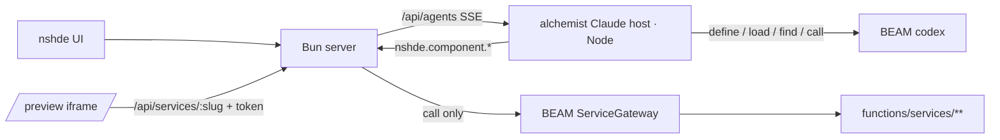
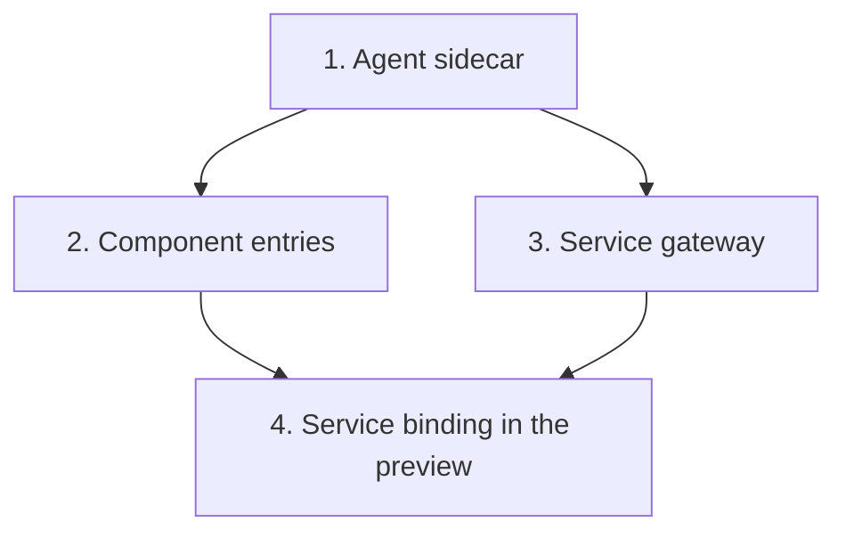

# Alchemist integration

The alchemist Claude host becomes the nshde agent.
It writes frontend components to nshde storage and backend services as Elixir codex entries.
Components call published services through a call-only gateway.

## Shape

## Dependency graph

## Slices

### 1. Agent sidecar

- The alchemist Claude host runs as its own Node process. Alchemist does not run under Bun.
- The sidecar exposes one HTTP endpoint that streams a session over SSE.
- `/api/agents` proxies to the sidecar and replaces `generateModuleFromPrompt`.
- The agent panel renders streamed messages in the conversation tab.
- Config: `NSHDE_AGENT_URL` (sidecar base URL).

### 2. Component entries

Codex entries under `functions/nshde/` that call the nshde storage API:

- `nshde.component.write` — write `components/<slug>.nsh.tsx`. The preview hot-mounts it.
- `nshde.component.read` / `nshde.component.list`
- `nshde.component.check` — compile with Sucrase on the nshde side and return errors.

nshde adds `POST /api/modules/check` for the compile step.

### 3. Service gateway

- A service is a codex entry under `functions/services/<name>/`.
- Its `meta.json` carries `service.input_schema` and `service.output_schema` (JSON Schema).
- Published services are listed in a manifest of `{ slug, source_sha256 }`. Publish is an action in the nshde UI.
- `Runtime.ServiceGateway` is a second BEAM listener. It accepts only `call`, only for manifest slugs whose current `source_sha256` matches.
- Each call validates input and output against the schemas and runs in a task with a timeout and `max_heap_size`.
- nshde exposes `POST /api/services/:slug`, which forwards to the gateway.
- The explorer lists services (read-only).

### 4. Service binding in the preview

- The loader allows a virtual module `@nshde/services` with `call(slug, args)` and `useService(slug, args)`.
- A component declares `export const capabilities = ["service:<slug>"]`.
- The IDE mints a short-lived token scoped to those slugs and passes it to the preview. `/api/services/:slug` checks it.
- CORS is limited to the IDE origin.
- TypeScript types for service calls are generated from the schemas.

## Out of scope

Running services on a separate BEAM node, signed packages.

## Done when

- A prompt produces a component and a service; the component renders in the preview and shows data from the service.
- `/api/services/:slug` refuses unpublished slugs, changed sources, and calls without a matching token.
