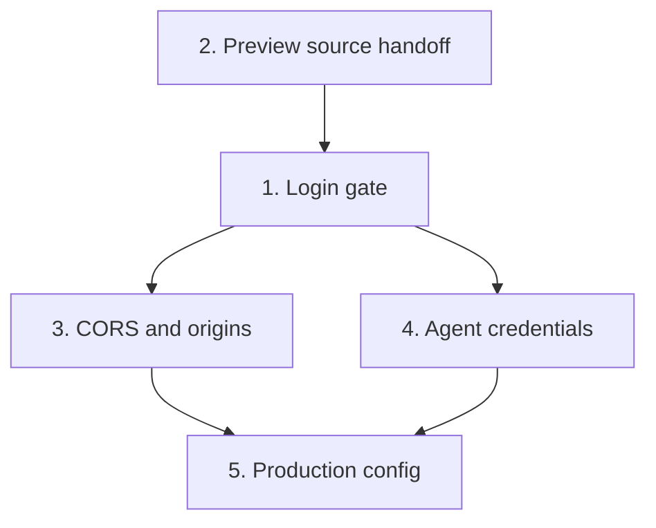

# Access control

The deployed instance (Koyeb) is open: every `/api` route works without credentials and most send `Access-Control-Allow-Origin: *`.
Anyone with the URL can read, write and delete storage, switch the storage backend, and start agent turns on the owner's Claude credentials.

This plan puts a login in front of the IDE and the API, and keeps the preview sandbox as the boundary for agent-written code.

## Shape

```mermaid
flowchart LR
  Browser[IDE · nshde origin] -->|session cookie| Gate{Gate}
  Gate --> API[/api/*]
  Gate --> UI[packaged NSH UI]
  Preview[/preview iframe · origin null/] -->|no cookie| Open[/preview assets/]
  Preview -->|Bearer service token| Services[/api/services/:slug/]
  Browser -.->|postMessage: module source| Preview
  Agent[alchemist sidecar] -->|Bearer agent token| Gate
```

## Threat model

| Actor | Has | Must not |
| --- | --- | --- |
| Anonymous internet | The URL | Load the UI, call any `/api` route except a token-checked service call |
| Other websites in the owner's browser | The owner's cookie, if `SameSite` allowed it | Make the server act (CSRF) or read responses (CORS) |
| Agent-written module in the preview | Opaque origin, its service token | Read or write storage, mint tokens, publish, start agent turns |
| Agent sidecar | Agent token | Anything beyond the component entries' routes |

Out of scope: several users, roles, per-user storage. One owner, one password.

## Dependency graph



Slice 2 lands before or with slice 1: once the gate is on, the preview can no longer read `/api/storage`, so it must already get source another way.

## Slices

### 1. Login gate

A check at the top of `Bun.serve` that runs before routes and static files.

- **Enabled** when `NSHDE_PASSWORD` is set. Unset means open (local dev, tests). In `NODE_ENV=production` the server refuses to start without it unless `NSHDE_AUTH=off` is set explicitly.
- **Login**: `GET /login` serves a minimal HTML form (no NSH bundle needed). `POST /login` takes `password` (form-encoded), compares with `timingSafeEqual` on SHA-256 digests, and on success sets the session cookie and redirects to `/`. A wrong password answers 401 after a fixed delay.
- **Rate limit**: at most 10 failed logins per 15 minutes per client IP (`X-Forwarded-For` first hop, as Koyeb sets it), in memory. Beyond that, 429.
- **Session cookie** `nshde_session`: `<payload>.<sig>`, payload `{ "e": <expiry ms>, "v": <session version> }`, HMAC-SHA256 with `NSHDE_SESSION_SECRET` (falls back to a per-process random key, which logs everyone out on restart). Attributes: `HttpOnly; Secure; SameSite=Strict; Path=/; Max-Age=<ttl>`. TTL `NSHDE_SESSION_TTL_HOURS`, default 168 (7 days). `Secure` is dropped only when the request is plain `http://localhost`.
- **Logout**: `POST /logout` clears the cookie. Bumping `NSHDE_SESSION_VERSION` (default `1`) and redeploying ends every session.
- **Reuse** the HMAC helpers in `src/lib/services/token.ts`. Move the generic sign/verify into `src/lib/auth/signed.ts` and keep service tokens on top of it.
- **Unauthenticated responses**: a navigation (`Accept: text/html`) redirects to `/login`; anything else gets `401 { "error": "unauthorized" }`.
- **Exempt paths** (no cookie needed):
  - `/login`, `/logout`, `/favicon.ico`, `/healthz` (new: `200 ok`, no data, for the Koyeb health check)
  - `/preview`, `/preview/blank`, `/preview/runtime.js`, `/preview/runtime.css`: static, generic, no user data
  - `POST/OPTIONS /api/services/:slug`: already needs a scoped service token
- **CSRF**: `SameSite=Strict` plus slice 3 (refusing foreign `Origin` on every state-changing request). No separate CSRF token.
- The IDE client (`src/nshde/api.ts`) sends no extra headers: the cookie is same-origin. On a 401 it reloads to `/login`.
- In dev (`nsh run` on `:8790`, API on `:43123`) the UI and API are cross-origin, so the cookie would not flow. With the gate on in dev, fetches use `credentials: "include"` and the API allows the dev origin with `Access-Control-Allow-Credentials: true`. With the gate off, nothing changes.

### 2. Preview source handoff

The preview stops fetching `/api/storage`. The IDE gives it the module instead.

- The IDE reads the module (it already does, for the editor) and sends it to the preview `WebView` with `postMessage({ type: "nshde.mount", path, source | wasm, serviceToken? })`.
  - `.nsh.tsx`: `source` as a string.
  - `.wasm`: `wasm` as an `ArrayBuffer`, transferred.
- The preview (`src/preview/main.tsx`) listens for `message`, accepts only `event.source === window.parent` and a well-formed `nshde.mount`, and mounts it. The IDE origin cannot be checked from inside the opaque frame, so the check is on the source window. The payload is only code to run in the sandbox, which the preview runs anyway.
- The preview posts `{ type: "nshde.ready" }` when loaded so the IDE does not send too early; the IDE resends on every save and on **run**.
- The service token moves from the URL fragment into this message, so it no longer sits in the frame URL.
- If the NSH `WebView` gives no handle to the frame's `contentWindow` on the web target, the fallback is a one-module read token: `POST /api/preview-tokens { path }` (gated) returns a token for that path with a 10-minute TTL, and `GET /api/preview-source?path=…` with `Authorization: Bearer <token>` is exempt from the gate. Check the `WebView` API first and record which path was taken here.
- `GET /api/storage` loses `*` CORS (slice 3), so the module in the preview cannot read other modules either.

### 3. CORS and origins

- Every route uses the policy in `src/lib/api/origin.ts`. Remove the `*` headers in `src/server.ts` and `json()` in `src/lib/api/http.ts`.
- Allowed origins: `NSHDE_IDE_ORIGIN` when set, else the server's own origin, plus `http://localhost:*` / `127.0.0.1:*` outside production (current rule).
- `Origin: null` is accepted only on `/api/services/:slug` (current rule).
- Any `POST`/`DELETE` whose `Origin` is present and not allowed gets 403 before the handler (current `withRestrictedCors` behavior, now on all routes). A missing `Origin` is allowed, because the gate already requires the cookie or agent token.
- `Access-Control-Allow-Credentials: true` only for allowed, non-null origins.
- `POST /api/storage { backend }` (switching the storage backend at runtime) is refused in production unless `NSHDE_ALLOW_BACKEND_SWITCH=1`.
- Security headers on the UI and API: `X-Content-Type-Options: nosniff`, `Referrer-Policy: no-referrer`, `Strict-Transport-Security: max-age=31536000` (when `Secure`). A CSP on the IDE page is a follow-up once the NSH bundle's script needs are known.

### 4. Agent credentials

The alchemist sidecar calls back into nshde (`nshde.component.*` → `NSHDE_API_URL`). With the gate on it needs its own credential, and the sidecar itself must not be open either.

- **Agent → nshde**: `NSHDE_AGENT_API_TOKEN` (random, 32+ bytes), shared by both sides. nshde accepts `Authorization: Bearer <it>` instead of a cookie, but only on:
  - `GET /api/storage?path=components/…` and `?tree=1`
  - `POST /api/storage` with a `path` under `components/` (no `backend` switch)
  - `POST /api/modules/check`
  Anything else with the agent token gets 403.
- **nshde → sidecar**: `NSHDE_SIDECAR_TOKEN`. `openSidecarStream` sends `Authorization: Bearer <it>`; the sidecar refuses requests without it. Needed as soon as the sidecar is reachable from anywhere but loopback (plan 008).
- alchemist side (`hosts/nshde/sidecar.ts`, `functions/lib/agent_lib/nshde.ex`): read both variables, send and check the headers. Same variable names on both sides.
- Comparisons use `timingSafeEqual`.

### 5. Production config

Koyeb service settings, documented in the README's Koyeb section:

| Variable | Kind | Value |
| --- | --- | --- |
| `NSHDE_PASSWORD` | Secret | Long passphrase |
| `NSHDE_SESSION_SECRET` | Secret | 32 random bytes, base64 |
| `NSHDE_SERVICE_SECRET` | Secret | 32 random bytes, base64 |
| `NSHDE_AGENT_API_TOKEN` | Secret | 32 random bytes, base64 (only with an agent) |
| `NSHDE_SIDECAR_TOKEN` | Secret | 32 random bytes, base64 (only with an agent) |
| `NSHDE_IDE_ORIGIN` | Plain | `https://<app>.koyeb.app` (and the custom domain, comma-separated) |

- The Koyeb health check moves to `/healthz`. `/` and `/api/config` now answer 302/401.
- `openssl rand -base64 32` for each secret.

## Tests

- Gate: each exempt path answers without a cookie; every other route answers 401 or redirects; a valid cookie passes; an expired, tampered, or old-version cookie fails; the login rate limit returns 429.
- Agent token: allowed on the listed routes only; 403 on `backend` switch, service manifest, tokens, agents.
- CORS: a foreign `Origin` POST is refused on every route; `null` only on service calls; no `*` anywhere.
- Preview: mounts from a `nshde.mount` message; ignores messages not from `window.parent`; makes no `/api/storage` request (assert in the existing preview test).
- Production boot without `NSHDE_PASSWORD` fails unless `NSHDE_AUTH=off`.

## Done when

- On Koyeb, an anonymous `curl` of `/`, `/api/storage?tree=1` and `POST /api/agents` gets 302/401.
- After logging in, the IDE works as before: edit, save, run, agent turn, service call from a mounted component.
- A component in the preview cannot read `/api/storage` or call any route but its scoped services.
- CONTEXT.md and README describe the gate, exempt paths, and variables.

## Out of scope

Several users and roles, OAuth/SSO (an identity-aware proxy such as Cloudflare Access can be put in front later; it then needs the app to check the proxy's header so the `*.koyeb.app` URL cannot bypass it), CSP for the IDE page.
