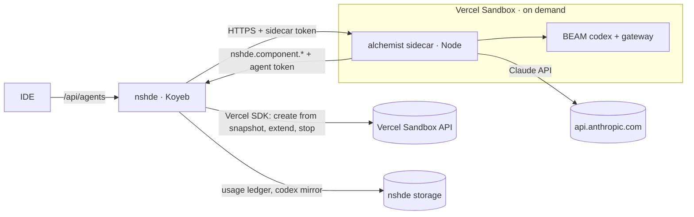
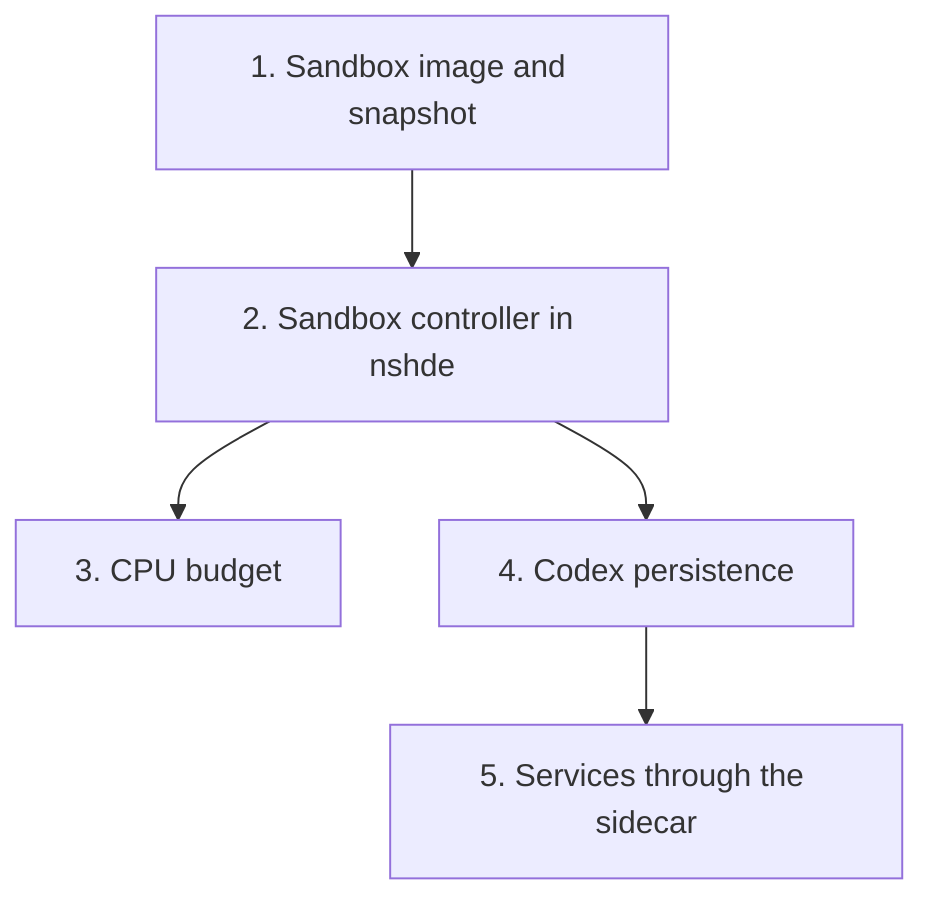

# Agent in a Vercel Sandbox

nshde runs on Koyeb; the agent (alchemist sidecar + BEAM) has no deployment yet.
This plan runs the agent on demand in a [Vercel Sandbox](https://vercel.com/docs/vercel-sandbox) on the Hobby plan, started by the nshde server, and keeps it inside the free allowance.

Depends on plan 007: the sidecar and its callbacks need the agent and sidecar tokens.

## Why a sandbox

- The agent defines and runs Elixir (codex `define` / `call`). That is agent-written code; it should not share a machine with nshde's secrets and storage.
- The agent is idle most of the time. A sandbox that exists only while someone is prompting costs nothing in between.
- The Koyeb free instance (if that is the tier in use) is too small for nshde, a BEAM, Node and the Claude Code process together.

Fallback if the spike in slice 1 fails: a second Koyeb service running the sidecar, private to the Koyeb mesh, with the same tokens.

## Hobby limits that shape the design

From Vercel's sandbox pricing page (verify at implementation time; figures move):

| Limit | Hobby |
| --- | --- |
| Active CPU | 5 hours / month |
| Memory | 420 GB-hours / month |
| Sandbox creations | 5,000 / month |
| Max lifetime of one sandbox | 45 minutes |
| Concurrent sandboxes | 10 |
| Overage | None: sandboxes stop until the allowance resets |

Consequences:
- No surprise bill. The risk is the agent being unavailable for the rest of the month.
- Active CPU counts only time the CPU works. An agent turn mostly waits on the Claude API, so it is cheap; installing and compiling is expensive, and so is anything that spins while idle.
- A sandbox lives at most 45 minutes, so nothing in it persists unless synced out.

## Shape

## Dependency graph

## Slices

### 1. Sandbox image and snapshot (spike first)

Goal: a snapshot from which the sidecar is ready in seconds, with no install or compile at start.

- Base: the Node 24 sandbox runtime.
- Install Erlang/OTP and Elixir matching alchemist's `flake.nix` (from the distro packages if versions fit, else prebuilt OTP/Elixir tarballs; not Nix, which is slow to bootstrap).
- Clone alchemist at a pinned commit, `npm ci`, `cd runtime && mix deps.get && mix compile` (so the bridge's `mix compile` is a no-op at start).
- Snapshot the sandbox. The snapshot id is `NSHDE_AGENT_SNAPSHOT`.
- Script: `bun run agent:snapshot` (in nshde, `scripts/agent-snapshot.ts`) does all of the above through the SDK and prints the snapshot id. It is run by hand, once per alchemist upgrade. It is the expensive step and is charged to the budget (slice 3).
- No secrets in the snapshot. `ANTHROPIC_API_KEY` and tokens are passed as env when the sidecar command starts.
- Record in this plan: OTP/Elixir versions, snapshot size, measured cold start (create → sidecar `listening`), how long Vercel keeps a snapshot.

Spike exit criteria: from the snapshot, the sidecar answers `POST /sessions` within 15 s and a turn writes a component back to a local nshde. If not reachable, take the fallback above.

### 2. Sandbox controller in nshde

`src/lib/agents/sandbox.ts`, used by `/api/agents` when `NSHDE_AGENT_MODE=vercel` (else `NSHDE_AGENT_URL` as today).

- **Auth to Vercel**: `@vercel/sandbox` with an access token: `VERCEL_TOKEN`, `VERCEL_TEAM_ID`, `VERCEL_PROJECT_ID` (Koyeb secrets).
- **One sandbox at a time.** The controller holds `{ id, url, startedAt, lastTurnAt }` in memory and in storage (`.nshde/agent-sandbox.json`) so a nshde restart reattaches instead of starting a second one.
- **Start** on the first turn: create from `NSHDE_AGENT_SNAPSHOT`, smallest vCPU size, port `43124` exposed, `timeout` = idle window. Run the sidecar detached with:
  - `NSHDE_SIDECAR_HOST=0.0.0.0`, `NSHDE_SIDECAR_TOKEN`, `NSHDE_API_URL=<NSHDE_IDE_ORIGIN>`, `NSHDE_AGENT_API_TOKEN`, `ANTHROPIC_API_KEY`, `NSHDE_AGENT_MODEL`
  - `ELIXIR_ERL_OPTIONS="+S 2:2 +sbwt none +sbwtdcpu none +sbwtdio none"`: stops the BEAM schedulers from busy-waiting while idle, which would otherwise count as active CPU.
  - Wait for the sidecar's port, then use the sandbox's public URL for that port as the sidecar base URL.
- **Concurrent first turns** wait on the same start promise.
- **Idle stop**: idle window `NSHDE_AGENT_IDLE_MIN`, default 5. Each turn extends the timeout to `now + idle window`. The controller stops the sandbox itself after the idle window (after slice 3's final sample and slice 4's sync); Vercel's timeout is the backstop.
- **Lifetime cap**: `NSHDE_AGENT_MAX_LIFETIME_MIN`, default 40 (under Hobby's 45). A turn is not started on a sandbox that would hit the cap mid-turn: it is synced, stopped, and a new one started.
- **Turn cap**: `NSHDE_AGENT_TURN_MAX_MIN`, default 10. The controller aborts the upstream stream and sends an `error` event.
- **UI**: the agent panel shows `starting agent…` during the cold start (a new `status` SSE event from `/api/agents`).
- **Egress**: if the sandbox network policy allows it, restrict outbound traffic to `api.anthropic.com`, the nshde host, and package registries only for the snapshot script.

### 3. CPU budget

Keep usage under the 5-hour allowance with headroom, and fail clearly instead of hitting the wall.

- **Budget**: `NSHDE_AGENT_CPU_BUDGET_MIN`, default 240 (4 of the 5 hours; the rest covers snapshot builds and measurement error).
- **Period**: the Vercel billing cycle. `NSHDE_AGENT_BUDGET_RESET_DAY` (1–28, default 1, UTC) sets when the ledger rolls over.
- **Measure** active CPU inside the sandbox from `/proc/stat` (the `cpu` line: user + nice + system + irq + softirq, in `USER_HZ`):
  - Baseline right after start.
  - Sample at the end of each turn and right before stop. One `cat /proc/stat` per sample.
  - Charge `sample − previous sample` to the ledger.
- **Lost sandbox** (crashed, timed out before the final sample): charge the time since the last sample × vCPU count. This overestimates, which is the safe side.
- **Snapshot builds**: the script samples the same way and charges the ledger.
- **Ledger**: `.nshde/agent-usage.json` in storage: `{ period, cpuSeconds, wallSeconds, sandboxes, turns, samples: [...] }`. `GET /api/agents/usage` returns it (gated).
- **Enforcement** before a sandbox start and before each turn:
  - ≥ 80 %: the turn runs; the panel shows a warning with minutes left.
  - ≥ 100 %: `429 { "error": "agent CPU budget used up until <reset date>" }`, and no sandbox is started.
- **Claude spend** is separate from Vercel CPU: `NSHDE_AGENT_MAX_TURNS_PER_DAY`, default 50, counted in the same ledger.
- **Reconcile**: Vercel's usage page is the truth. If the ledger drifts from it by more than 20 %, tune the budget; the README says where to look.

Rough expectation, to check in the spike: a turn spends seconds of active CPU, so 240 minutes is hundreds of turns. Starts from snapshot are the next cost; snapshot builds the largest.

### 4. Codex persistence

The sandbox is thrown away; the agent's work must not be.

- Components already persist: `nshde.component.write` writes to nshde storage.
- **Codex entries** the agent defines (`functions/**` under the alchemist checkout, minus the entries shipped in the snapshot) are mirrored into nshde storage under `codex/`:
  - After each turn and before stop, the controller lists files changed since start in the sandbox and copies them to storage.
  - On start, the controller writes `codex/**` from storage into the sandbox before starting the sidecar.
- **Agent memory and Claude sessions**: the alchemist state dir and the Agent SDK's session transcripts are synced the same way (`agent-state/`), so `sessionId` resumes across sandboxes. If the transcripts are too large or awkward to move, v1 resumes only within one sandbox's life and the panel starts a new session after a restart; record which.
- Storage on Koyeb: `fs` storage inside the container is lost on redeploy. Use a Koyeb volume or `s3` storage before relying on the mirror. Decide in this slice.

### 5. Services through the sidecar

Today nshde reads services from a local `ALCHEMIST_DIR` and calls the gateway on `127.0.0.1`. Neither exists on Koyeb.

- **Listing**: `serviceConfig` gets a storage-backed variant that reads `codex/services/**` from the mirror. The registry logic (schemas, `source_sha256`, stale) is unchanged.
- **Manifest**: Publish writes `services.json` to storage and, when a sandbox is up, into its state dir.
- **Calls**: the sidecar adds `POST /services/:name` (sidecar token required). It forwards to the local `Runtime.ServiceGateway` over its framed TCP protocol and returns the JSON. nshde's `handleServiceCall` uses this instead of `callGateway` when `NSHDE_AGENT_MODE=vercel`.
- **Availability**: a service call needs a running sandbox. v1 does not start one for a service call: it answers `503 gateway_down` with "start the agent to run services". Starting a sandbox on a service call is a follow-up, behind the same budget.
- alchemist side: the sidecar route, and its README.

## Configuration (Koyeb)

| Variable | Kind | Default |
| --- | --- | --- |
| `NSHDE_AGENT_MODE` | Plain | `url` (`vercel` to enable this plan) |
| `VERCEL_TOKEN` | Secret | |
| `VERCEL_TEAM_ID`, `VERCEL_PROJECT_ID` | Plain | |
| `NSHDE_AGENT_SNAPSHOT` | Plain | |
| `ANTHROPIC_API_KEY` | Secret | |
| `NSHDE_SIDECAR_TOKEN`, `NSHDE_AGENT_API_TOKEN` | Secret | (plan 007) |
| `NSHDE_AGENT_IDLE_MIN` | Plain | `5` |
| `NSHDE_AGENT_MAX_LIFETIME_MIN` | Plain | `40` |
| `NSHDE_AGENT_TURN_MAX_MIN` | Plain | `10` |
| `NSHDE_AGENT_CPU_BUDGET_MIN` | Plain | `240` |
| `NSHDE_AGENT_BUDGET_RESET_DAY` | Plain | `1` |
| `NSHDE_AGENT_MAX_TURNS_PER_DAY` | Plain | `50` |

## Tests

- Controller with a fake SDK: one sandbox for concurrent first turns; reattach after restart; idle stop; lifetime cap rolls over to a new sandbox; turn cap aborts.
- Budget: `/proc/stat` deltas add up; a lost sandbox is charged wall time × vCPU; 80 % warns; 100 % refuses before starting a sandbox; period rollover on the reset day.
- Persistence: files changed in the sandbox appear under `codex/`; a new sandbox gets them back.
- Services: listing from the storage mirror; calls go through the sidecar route; no sandbox → 503.

## Done when

- From the Koyeb IDE, a prompt starts a sandbox, writes a component that mounts in the preview, and the sandbox stops on its own after the idle window.
- A second prompt after the stop gets a fresh sandbox with the earlier codex entries.
- The usage ledger matches Vercel's usage page within 20 %, and a turn past the budget is refused without starting a sandbox.

## Open questions

- Is Koyeb on the free tier? It decides whether the slice-1 fallback (second Koyeb service) fits.
- Vercel snapshot retention: if snapshots expire, the controller needs to detect a missing snapshot and say so rather than build one silently.
- Does the sandbox port URL keep a long SSE stream open for a whole turn? Check in the spike.
